# Диагностика — руководство разработчика

Как видеть ошибки и зависания прямо в игре, как читать то, что пришло в Sentry, и как поручить разбор агенту.
Руководство для игроков и тестировщиков — [DIAGNOSTICS_GUIDE_PLAYERS_QA.md](DIAGNOSTICS_GUIDE_PLAYERS_QA.md).
Технический контракт (для агентов и кода) — [claude/diagnostics.md](claude/diagnostics.md).

Снимки — телевизор 4K. На клавиатуре: `M` — меню, `Enter` — A, `Esc` — B, `X` — X, `Q`/`E` — LB/RB, **F12** — журнал,
**Shift+F12** — Chrome DevTools.

---

## 1. Как всё устроено

```
   ЭКРАН ИГРЫ                     ПРИЛОЖЕНИЕ (main)               СЕРВЕР ПАРТИЙ (встроенный)
   ошибки, предупреждения ─┐      свои ошибки, сторож окна ─┐     исключения, сбои запросов ─┐
                           ▼                               ▼                               │
                    ЖУРНАЛ в игре  ◄───────────────  ХАБ  ◄─────────────────────────────────┘
                    (плашка, «Диагностика»)           │
                                                      ├─ решает, что отправить (ошибки сразу, зависание — одним событием)
                                                      ├─ вычищает id и имена
                                                      └─► Sentry (EU)  ──►  письмо вам  ──►  агент: `npm run diag`
   «Сообщить о проблеме» ─► ПАКЕТ (папка на устройстве + те же файлы вложениями в Sentry) ─► код TM-XXXXXX
```

- **Журнал** ведётся всегда, с первой секунды загрузки, и переживает перезагрузку экрана и перезапуск окна.
- **Отправляет только хаб** — и только из релизной сборки (с GitHub). Локальные сборки, dev-запуск и тесты не
  отправляют ничего.
- **Бокс** помечен как `box` (файл `~/.config/terraforming-mars/diagnostics.json`), релизы у игроков — `production`.

---

## 2. Включить и что видно в игре

**Настройки → ДИАГНОСТИКА → «Уведомления разработчика»**: `выкл.` (по умолчанию) · `Ошибки` · `Ошибки и зависания`.
Настройка хранится на устройстве — на боксе её достаточно включить один раз.

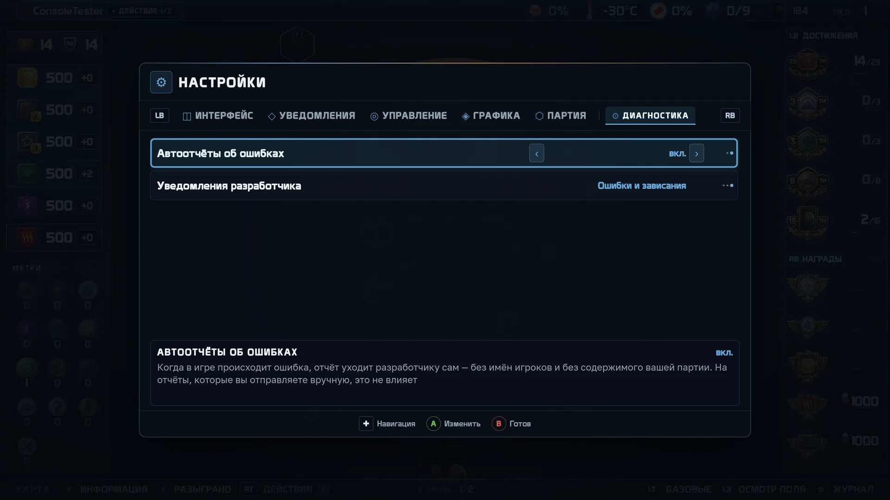

Теперь ошибка или зависание появляются в левом нижнем углу в момент, когда происходят. Плашка живёт вне игрового
экрана и его очередей — поэтому показывается и тогда, когда экран висит.

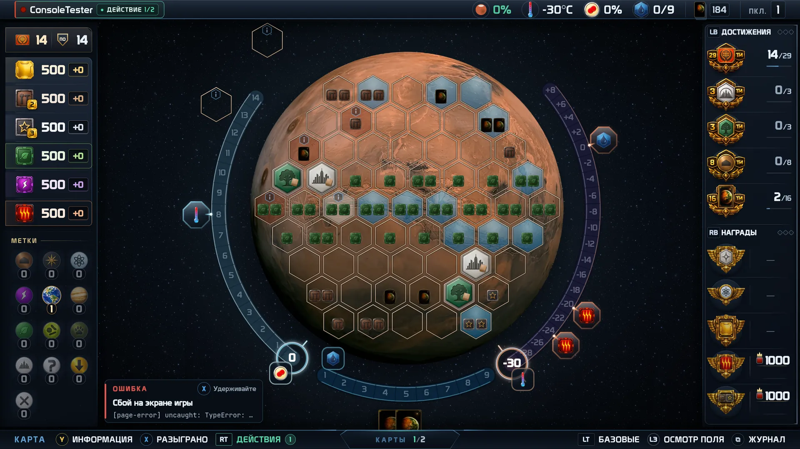

| На экране | Значение |
| --- | --- |
| **ОШИБКА**, красная кромка | исключение (или расхождение картинки с партией). Вторая строка — что случилось, третья — строка консоли |
| **ЗАВИСАНИЕ**, жёлтая кромка, «Всё ещё стоит — N с» | арбитр живости лечит экран прямо сейчас; плашка обновляется на месте |
| «Восстановлен за N с» | вылечено — игрок этого не увидел, но дефект есть |
| «Не восстановлен — стоял N с» | лестница релизов кончилась или экран перезагрузили под зависанием |
| значок `✕ 2 · ◷ 1` | плашка свернулась через 9 с (или показалась сразу значком — над открытым workspace свободного угла нет); счётчики — неоткрытые ошибки и зависания |

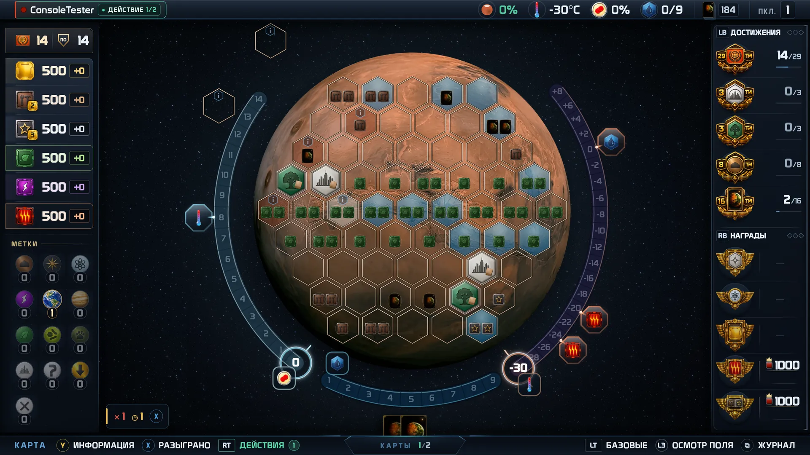

**Удерживайте X** (полсекунды, как на карточке события) — откроется запись целиком. Короткое нажатие X остаётся
обычным X экрана. Если на экране стоит карточка события — удержание X сначала её.

### Запись целиком

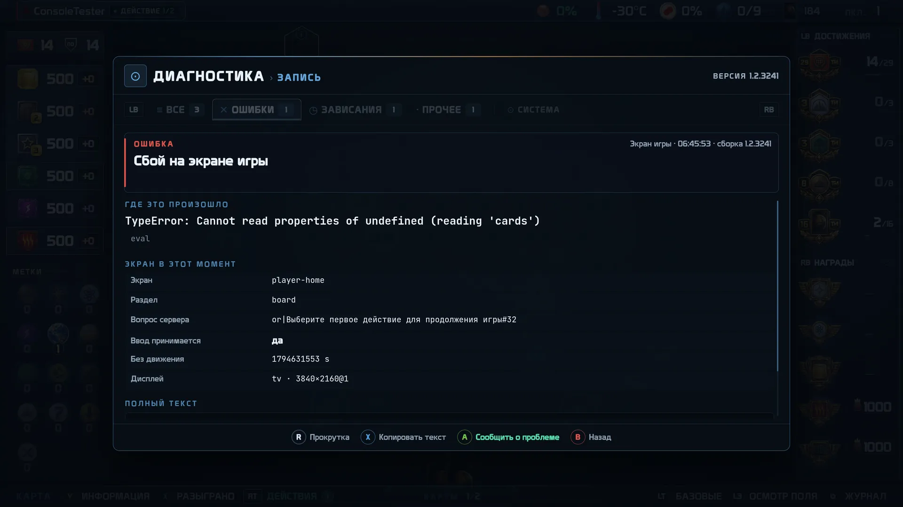

Запись, рождённая в коде игры, — её кадры прочитаны в `src/…:строка`:

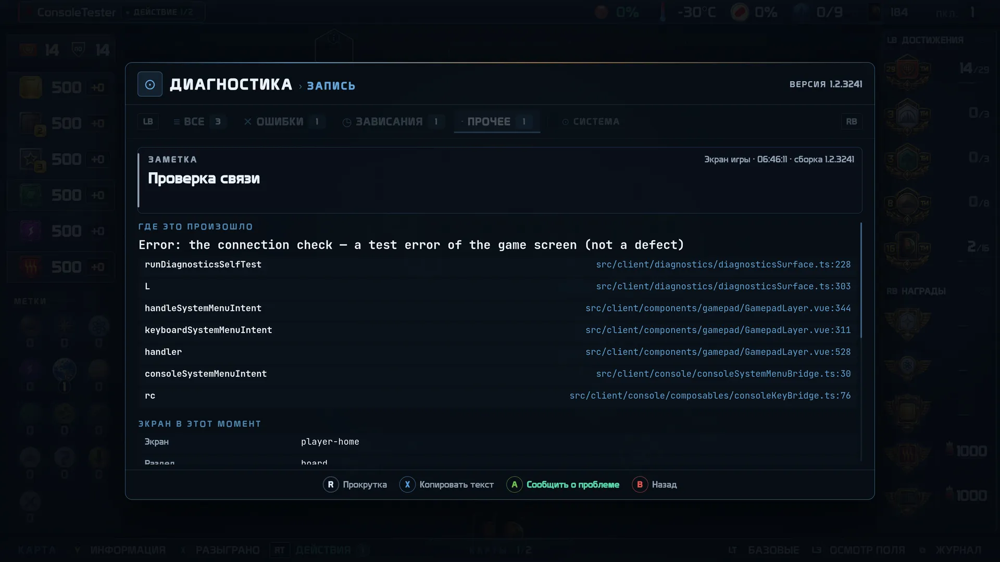

- **Где это произошло** — сообщение и стек. Кадры нашего кода прочитаны обратно в исходники (`src/…/файл.ts:строка`),
  кадры библиотек приглушены.
- **Как игра восстановилась** (для зависания) — причина, вопрос сервера, шаги лестницы по порядку.
- **Экран в этот момент** — экран, раздел, вопрос сервера, принимался ли ввод, что было в движении, стек workspace.
- **Полный текст** — дословно то, что ушло в консоль.

`R` (правый стик) или ✛ — прокрутка · **X — копировать текст** (в буфер обмена) · **A — сообщить о проблеме** (отчёт
будет привязан к записи) · B — назад.

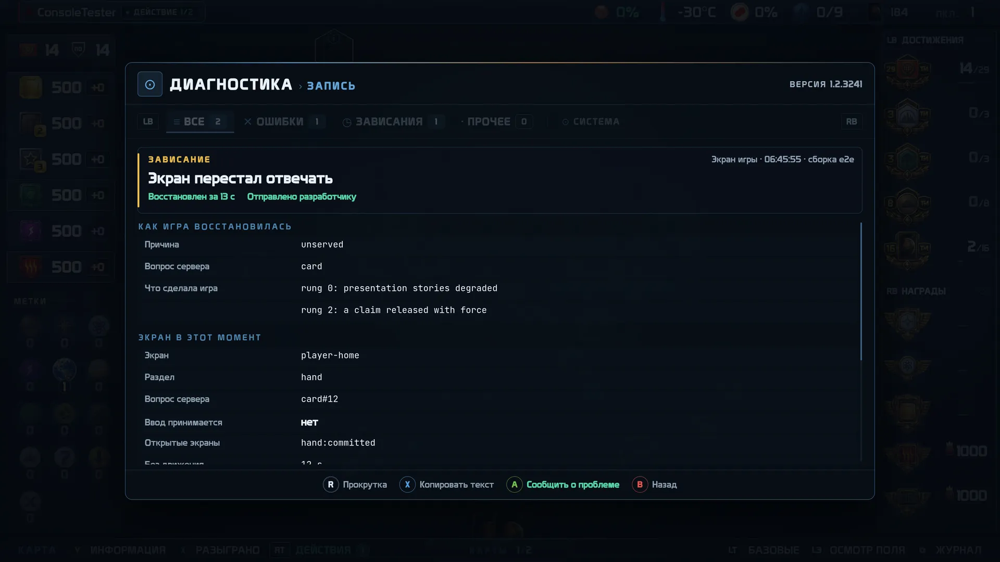

### Журнал

**Menu → «Диагностика»** или **F12**. Вкладки LB/RB: **ВСЕ · ОШИБКИ · ЗАВИСАНИЯ · ПРОЧЕЕ**, за чертой — **СИСТЕМА**.
Точка справа в строке: зелёная — событие у вас в Sentry, жёлтое кольцо — ждёт сети, серое — не отправлялось
(автоотчёты выключены / лимит сеанса / сборка не отправляет).

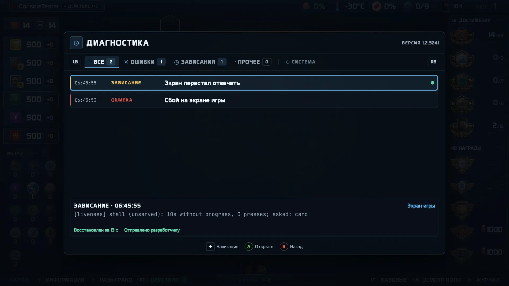

После перезапуска окна сторожем зависаний журнал показывает и то, что было **до** перезапуска: записи страницы,
строки сторожа (`renderer-hang`) и сервера.

«ПРОЧЕЕ» — заметки модулей и задержки кадров: в Sentry не уходят, но едут «хлебными крошками» со следующим событием.

---

## 3. Проверка связи — после обновлений

**Menu → «Диагностика» → СИСТЕМА → A.** Три тестовых события — экран игры, приложение, сервер партий; через
несколько секунд у каждого «Доставлено» или причина.

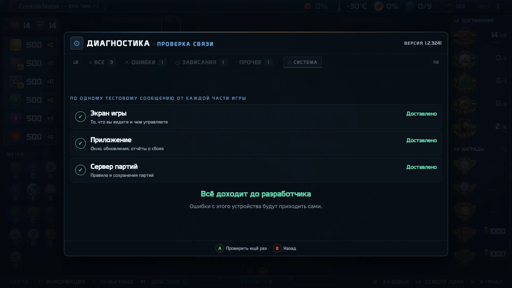

Вкладка **СИСТЕМА** показывает и состояние отправки: включена ли, тип сборки («Машина разработчика» = бокс), сколько
отчётов ждут сети, время последней доставки, папка отчётов.

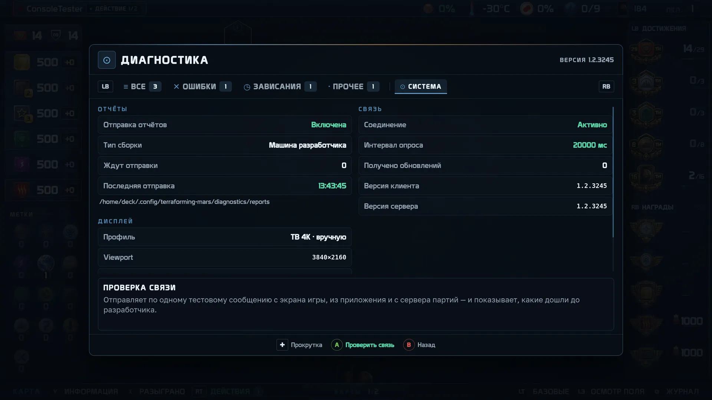

С ноутбука то же проверяет агент: `npm run diag -- selftest` — дошло ли из всех трёх мест и **приведены ли стеки к
исходникам** (это доказывает, что релиз загрузил карты).

Без рук, на любой машине: запуск игры с переменной `TM_DIAG_PROBE=1` — приложение само пройдёт проверку связи,
отправит пробный отчёт, напишет результат в `logs/main.log` и закроется.

---

## 4. Sentry в браузере

Адрес: **https://victor-zelinskiy.sentry.io** → проект **terraforming-mars**.

### Проблемы и фильтры
В строке поиска Issues работают теги игры:

| Запрос | Что покажет |
| --- | --- |
| `environment:box` / `environment:production` | бокс / игроки (переключатель окружения — вверху страницы) |
| `kind:error` · `kind:stall` · `kind:integrity` | ошибки · зависания · расхождения картинки с партией |
| `kind:report` | отчёты игроков |
| `report_code:TM-K7QW3D` | конкретный отчёт |
| `family:liveness` · `family:vue-error` · `family:page-error` · `family:server-error` · `family:renderer-hang` | семья сигнала (тег строки консоли) |
| `runtime:page` · `runtime:main` · `runtime:server` | где родилось |
| `screen:player-home` · `prompt_type:card` · `profile:tv` | где стоял игрок |
| `seat_ref:"p#3fa9c1d2e0"` | все события одного места за столом (отпечаток, не id) |
| `selftest:true` | проверки связи |

Зависание — **одно событие на эпизод**: заголовок «the screen stood still (причина, вопрос) — cured after N s / NOT
cured», в блоке `episode` — длительность и шаги лестницы.

### Отчёты игроков и вложения
Отчёт — отдельная проблема «Отчёт игрока TM-XXXXXX · категория — слова игрока». Внизу события — **Attachments**:
`report.json`, `journal.json`, `field_record.json`, `console_export.txt`, `screen.jpg`, `save.json` (если партия шла
на устройстве игрока), логи. Обычно проще не качать руками, а сказать агенту код (см. § 5).

### Релизы
**Releases** → `terraforming-mars@<версия>`: какая версия ещё шлёт события, новые проблемы версии. Релиз и карты
исходников создаёт CI при каждом пуше в `main`.

### Письма
Два правила (Alerts): штатное **«high priority issues»** — письмо о новой ошибке; и **«TM diagnostics — a new player
report or stall»** — письмо о новом отчёте игрока и новом зависании. Письмо приходит один раз на НОВУЮ проблему, а не
на каждое повторение. Отключить или сузить — Alerts → правило → Edit.

---

## 5. Работа с агентом

Скажите обычными словами — агент знает, что делать (скилл `diagnose-report`):

| Фраза | Что делает агент |
| --- | --- |
| **«разбери отчёт TM-K7QW3D»** | `npm run diag -- report TM-K7QW3D`: скачивает весь пакет в `.diagnostics/reports/…`, читает сводку, журнал, запись экрана, консоль, снимок, сохранение — находит причину в коде и говорит, что чинить |
| **«разбери последний отчёт»** | то же для самого свежего |
| **«что упало на боксе за сегодня»** | `npm run diag -- issues --env box --since 24h`, затем по каждой проблеме — событие, стек, экран |
| **«что падает у игроков за неделю»** | `npm run diag -- issues --env production --since 7d` |
| **«вытащи диагностику с бокса»** | `npm run diag -- box pull --since 24h`: логи приложения и сервера, папки отчётов, полевой журнал, экспорты консоли, трассы зависаний → `.diagnostics/box/…` с дайджестом |
| **«проверка связи дошла?»** | `npm run diag -- selftest` |

Агенту не нужен ни доступ к вашему браузеру, ни пересказ: в отчёте есть всё, включая сохранение партии.

---

## 6. Диагностика с бокса без отчёта

Если отчёта нет (игра зависла намертво, было не до меню):

1. Скажите агенту **«вытащи диагностику с бокса»** — он заберёт всё одной командой. Вручную то же лежит на боксе:

   | Что | Где (`ssh steam-machine`) |
   | --- | --- |
   | лог приложения (этот запуск и прошлый) | `~/.config/terraforming-mars/logs/main.log`, `main.prev.log` |
   | лог сервера партий (этот запуск и прошлый) | `~/.config/terraforming-mars/embedded/embedded-server.log`, `…prev.log` |
   | папки отчётов | `~/.config/terraforming-mars/diagnostics/reports/TM-XXXXXX/` |
   | отчёты, ждущие сети | `~/.config/terraforming-mars/diagnostics/outbox/` |
   | полевой журнал (экран по секундам) | `~/.config/terraforming-mars/embedded/db/field-log/*.jsonl` |
   | экспорты консоли, трассы зависаний окна | `~/Applications/*console_export*.txt`, `~/Applications/renderer-hang-*.trace.json` |
   | лог обёртки запуска | `~/Applications/terraforming-mars-steam.log` |
   | сохранения | `~/.config/terraforming-mars/embedded/db/files/` (+ `history/`) |

2. Автособытия зависания с бокса несут вложением дамп консоли (не чаще раза в 10 минут) — его видно в Sentry у события.
3. В автособытиях место за столом — отпечаток `p#…`. Найти сохранение: `npm run diag -- box resolve p#3fa9c1d2e0`.

---

## 7. Лимиты бесплатного плана Sentry

Developer: 1 пользователь, **5 000 ошибок в месяц**, **1 ГБ вложений**. Игра бережёт квоту сама:

- одна ошибка, повторяющаяся в цикле, — одна запись и одно событие;
- не больше 2 событий на один дефект, 8 на семью, 40 на запуск игры, 200 на устройство в сутки;
- заметки и задержки кадров не отправляются;
- отчёт — до ~19 МБ до сжатия (обычно 1–3 МБ); на устройстве хранятся 20 последних.

Сколько израсходовано — одной командой: `npm run diag -- key` (события и вложения за текущий расчётный период).

### Когда лимит исчерпан

Sentry перестаёт принимать события до конца расчётного периода. Игра отличает это от отсутствия сети и говорит
правду — игроку не предлагают «проверить интернет»:

- **отчёт** сохраняется на устройстве и уходит сам, когда лимит обновится; на экране — «Отчёт сохранён и уйдёт
  позже», «ваш интернет ни при чём»;

  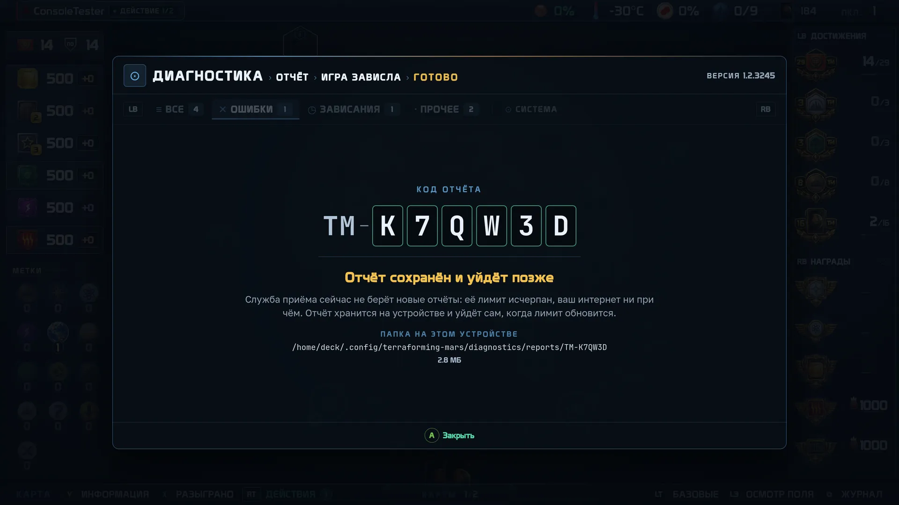

- **вкладка СИСТЕМА** — «Служба приёма переполнена», строкой ниже — сколько отчётов ждут, под группой — слово самого Sentry
  о причине (`usage_exceeded` — месячная квота, `key_quota` — предел ключа);

  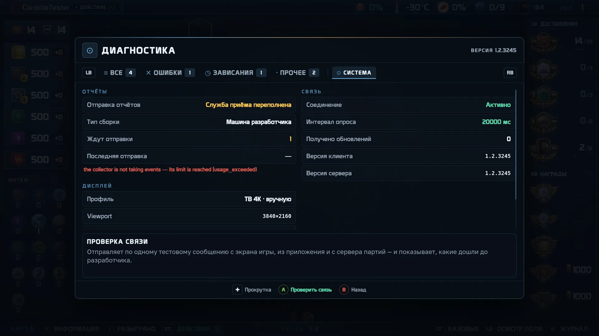

- **проверка связи** — «Служба приёма переполнена. Связь в порядке»;

  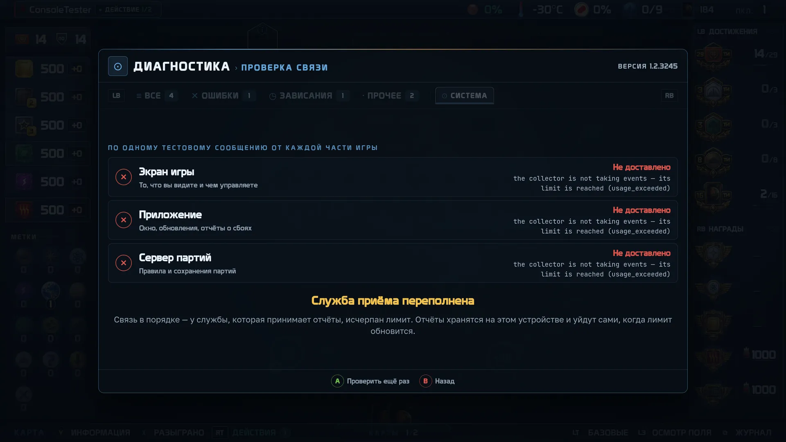

- квота **вложений отдельная**: если кончилась только она, отчёт приходит сводкой без файлов — экран говорит
  «Отчёт у разработчика — без файлов», а сами файлы лежат в папке на устройстве игрока.

Письма о новых проблемах в это время не приходят: Sentry их не видит.

### Ключ отправки — и что делать, если квоту кто-то сжигает

Ключ (DSN) зашит в игру, а значит, публичен: его можно достать из установленного приложения. Спрятать его нельзя;
можно не облегчать поиск, следить за расходом и уметь быстро заменить:

- ключа **нет в репозитории** и в открытом логе сборки — релиз берёт его из **секрета** GitHub `TM_SENTRY_DSN`
  (за этим следит тест);
- в Sentry включена защита от всплесков; на ключах стоит суточный предел 1000 событий (впятеро выше потолка одного
  устройства — вашим тестовым партиям он не мешает). ⚠ Предел на ключ — возможность платных планов: он работает,
  пока идёт пробный период Sentry (до 27.11.2026), дальше на него рассчитывать нельзя;
- **если расход растёт без причины** (`npm run diag -- key` показывает события, которых вы не порождали), ключ
  меняется за несколько минут:

  1. скажите агенту **«смени ключ Sentry»** — он выполнит `npm run diag -- key rotate` и покажет новый DSN;
  2. вставьте его в GitHub: *Settings → Secrets and variables → Actions → Secrets →* `TM_SENTRY_DSN`
     (это единственный шаг руками: у агента нет доступа к секретам репозитория);
  3. любой пуш — релиз соберётся с новым ключом, игры обновятся сами;
  4. после обновления бокса — «Проверка связи», затем агент отключает старый ключ (`key retire`).

Полная защита от намеренной заливки — собственный промежуточный сервис, который держит настоящий ключ у себя и
ограничивает поток по адресам. Он не построен: это отдельная инфраструктура (описание — `claude/diagnostics.md` § 12).

---

## 8. Приватность

| | Автоматически | По кнопке «Отправить отчёт» |
| --- | --- | --- |
| Текст ошибки, стек, экран, версия | да | да |
| id места и партии | **нет** — только отпечаток `p#…` | да (в `report.json`) |
| Имена игроков, имя учётной записи ОС | **нет** — заменяются на `<player>` / `<user>` | да |
| IP-адрес, город | **нет** | **нет** |
| Снимок экрана, дамп консоли, сохранение | нет (на боксе — дамп консоли, вычищенный) | да |

Игрок выключает автоотправку в «Настройки → ДИАГНОСТИКА → Автоотчёты об ошибках»; это же выключает отправку
нативных крашей. Зависания игроку не показываются никогда — только при включённых «Уведомлениях разработчика».

Канала связи для игроков пока нет: финальный экран отчёта говорит «отчёт уже у разработчика». Чтобы добавить контакт
— одно значение `DIAG_CONTACT` в `src/common/diagnostics/protocol.ts`.

---

## 9. Неполадки

| Симптом | Что проверить |
| --- | --- |
| «Проверка связи»: не доставлено | интернет на устройстве; вкладка СИСТЕМА → строка под группой «Отчёты» покажет последнюю ошибку отправки |
| «Служба приёма переполнена» | исчерпан лимит Sentry (`npm run diag -- key`): события и отчёты ждут на устройстве до конца расчётного периода; если расход не ваш — смените ключ (§ 7) |
| СИСТЕМА: «Эта сборка ничего не отправляет» | сборка не из релиза GitHub (локальная) — так и задумано |
| Событие в Sentry со стеком `main.js:1:…` вместо `src/…` | CI не загрузил карты этого релиза (шаг «Upload source maps» в Actions — жёлтое предупреждение); следующий релиз исправит |
| На боксе события приходят как `production` | нет файла `~/.config/terraforming-mars/diagnostics.json` с `{"environment": "box"}` |
| Плашки нет | «Уведомления разработчика» выключены на ЭТОМ устройстве; сигнал — заметка («Прочее»), а не ошибка/зависание |
| Нет письма | Sentry → Alerts: оба правила включены; письмо приходит только на НОВУЮ проблему |
| Игра не запускается после обновления | диагностика не может помешать запуску (её сбой пишется в `logs/main.log` строкой `[diagnostics] not installed`) — смотрите лог обёртки |

---

## 10. Все состояния поверхности (снимки с бокса, ТВ 4K)

Каждый шаг стоит в одной и той же карточке — она не двигается и не меняет размер (это меряет e2e
`console-diagnostics.spec.ts`).

| Состояние | Снимок |
| --- | --- |
| Плашка зависания («Всё ещё стоит…») | 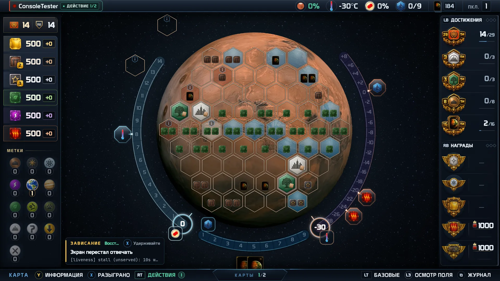 |
| Журнал пуст — что делать дальше | 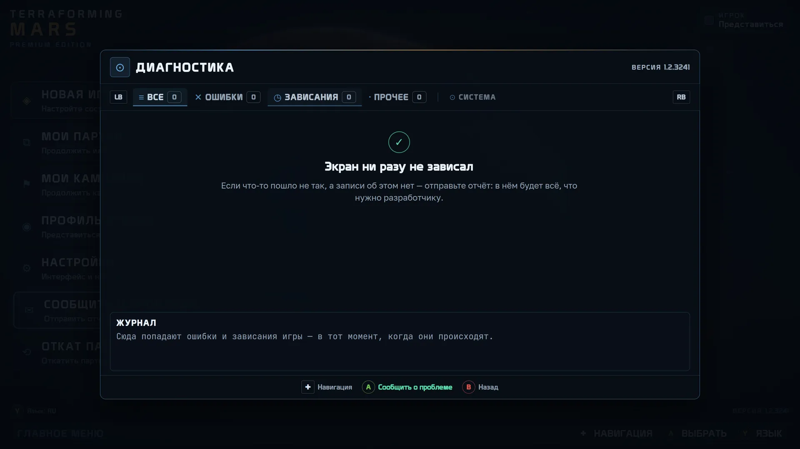 |
| Проверка связи идёт | 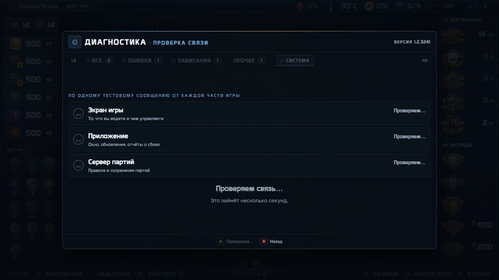 |
| Отчёт: что случилось | 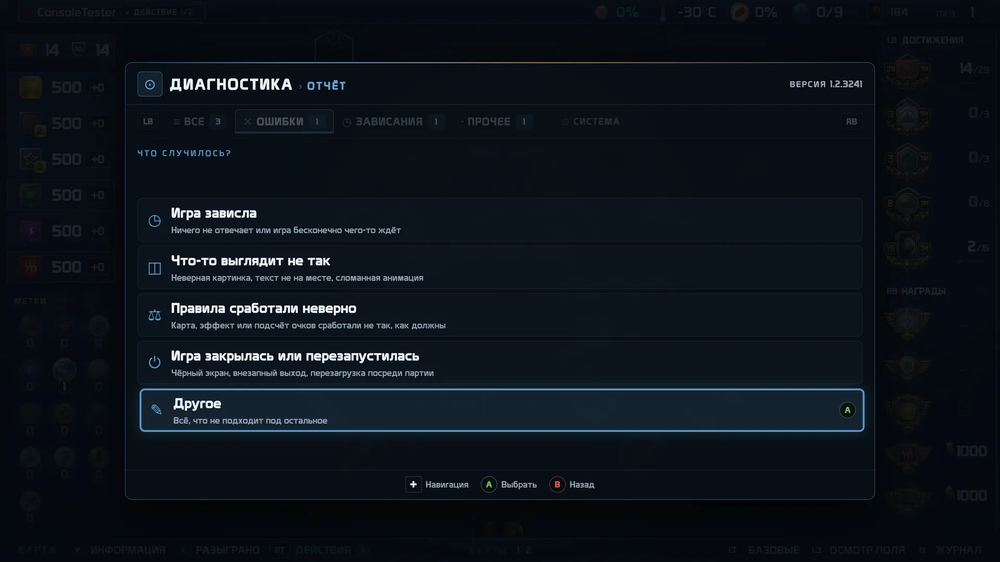 |
| Отчёт: состав перед отправкой | 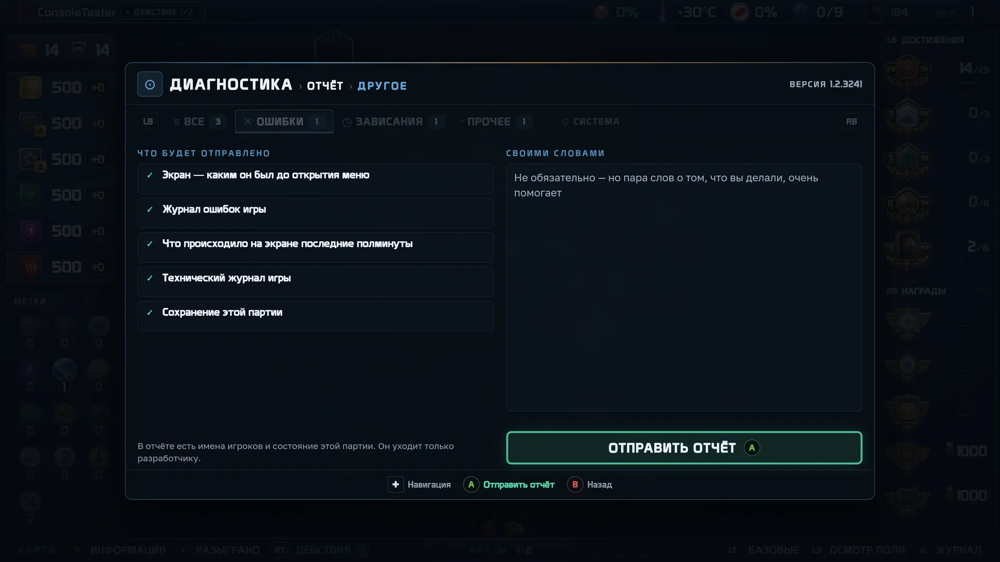 |
| Отчёт уходит (ввод поглощён, двойной отправки нет) | 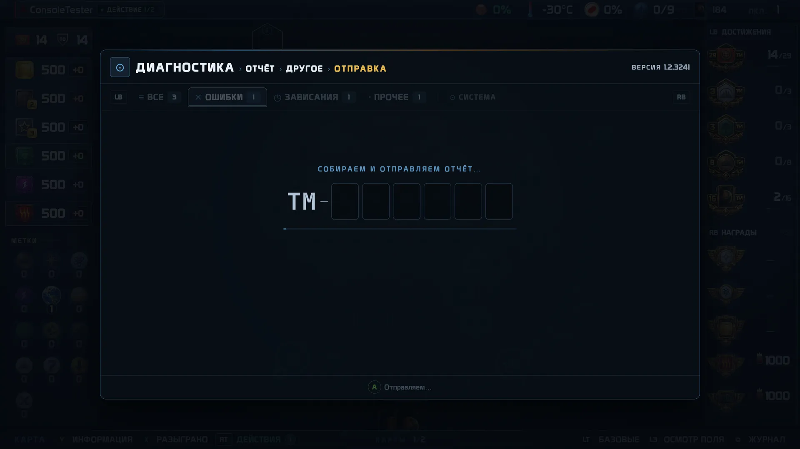 |
| Код отчёта | 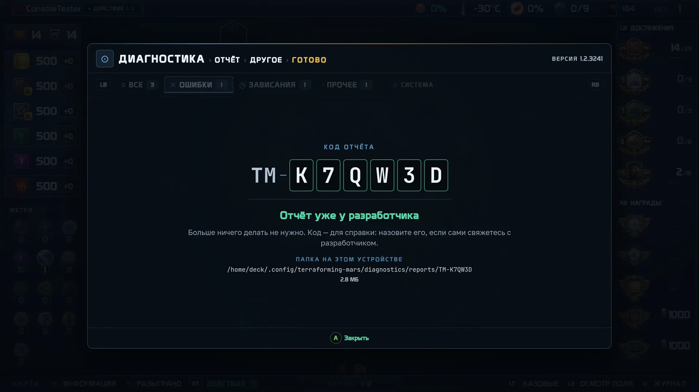 |
| Нет сети — отчёт ждёт | 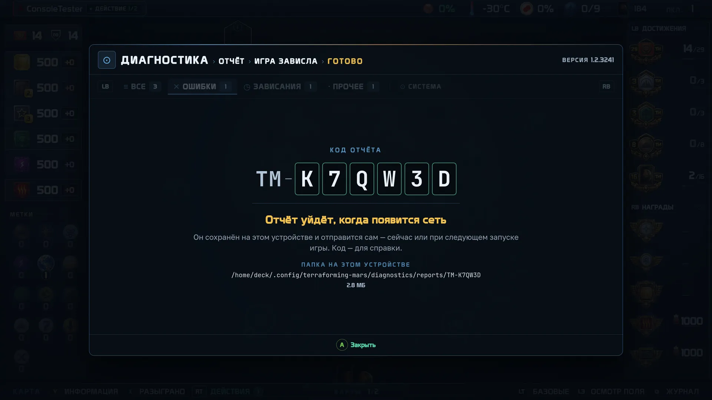 |
| Отчёт не собран — отказ с причиной | 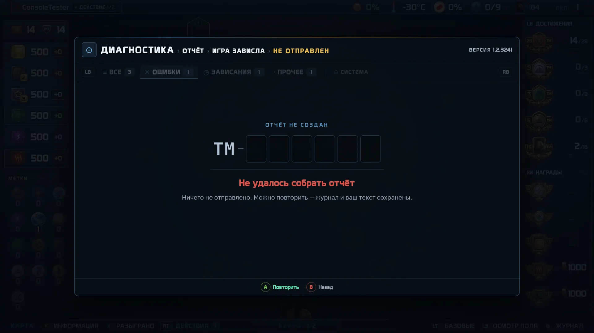 |
| Отчёт из главного меню | 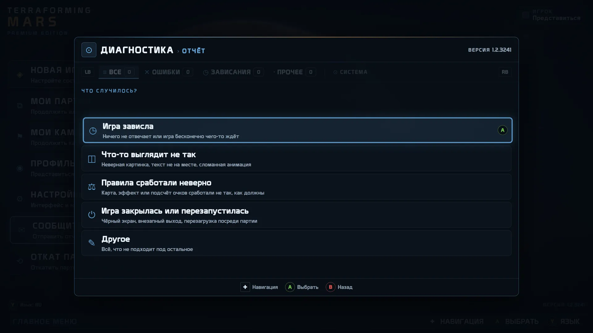 |
| Системное меню | 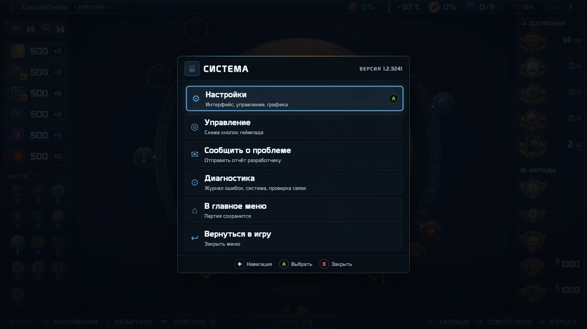 |
| Главное меню | 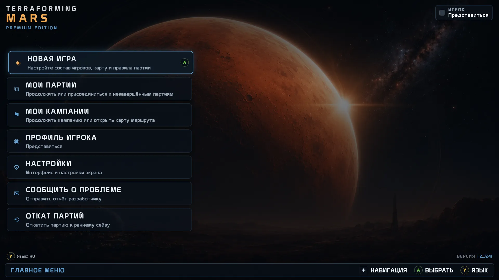 |

---

## 11. Шпаргалка

```
В ИГРЕ
  Menu → Сообщить о проблеме      отчёт с кодом
  Menu → Диагностика  (F12)       журнал · LB/RB — фильтры · A — запись · X — копировать
  Диагностика → СИСТЕМА → A       проверка связи
  удержание X на плашке           запись целиком
  Shift+F12                       Chrome DevTools
  Настройки → ДИАГНОСТИКА         «Автоотчёты об ошибках» · «Уведомления разработчика»

АГЕНТУ
  «разбери отчёт TM-…»   «что упало на боксе за сегодня»   «вытащи диагностику с бокса»

КОМАНДЫ (ноутбук)
  npm run diag -- report TM-XXXXXX | latest
  npm run diag -- issues --env box --since 24h [--kind error|stall|report] [--family liveness]
  npm run diag -- issue TERRAFORMING-MARS-12
  npm run diag -- selftest
  npm run diag -- box pull --since 24h
  npm run diag -- box resolve p#xxxxxxxxxx
  npm run diag -- key                     ключи и расход квоты · key rotate — новый ключ · key retire <id> — отключить старый

SENTRY
  https://victor-zelinskiy.sentry.io   ·   environment:box   kind:report   report_code:TM-…
```
