# Если в игре что-то пошло не так — руководство для игроков и тестировщиков

Этот документ состоит из двух частей: короткая — **для игроков**, подробная — **для тестировщиков (QA)**.
Все снимки сделаны на телевизоре 4K, управление — геймпад (на клавиатуре те же действия: `M` — системное меню,
`Enter` — A, `Esc` — B, `X` — X, `Q`/`E` — LB/RB).

---

## Часть 1. Игрокам

### Как сообщить о проблеме

1. **Во время партии** нажмите кнопку **Menu** на геймпаде — откроется системное меню. Выберите
   **«Сообщить о проблеме»**.
   В **главном меню** игры есть такой же пункт — «Сообщить о проблеме».

   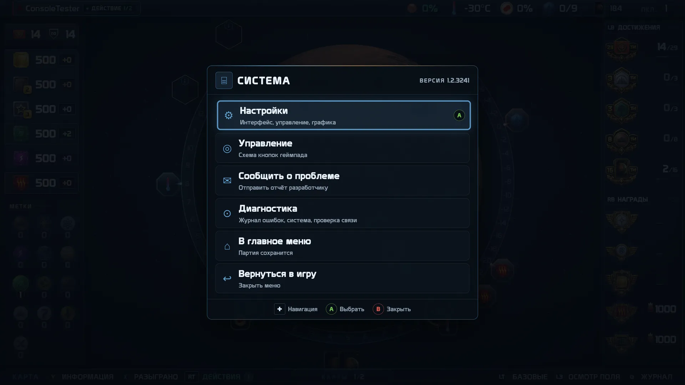

   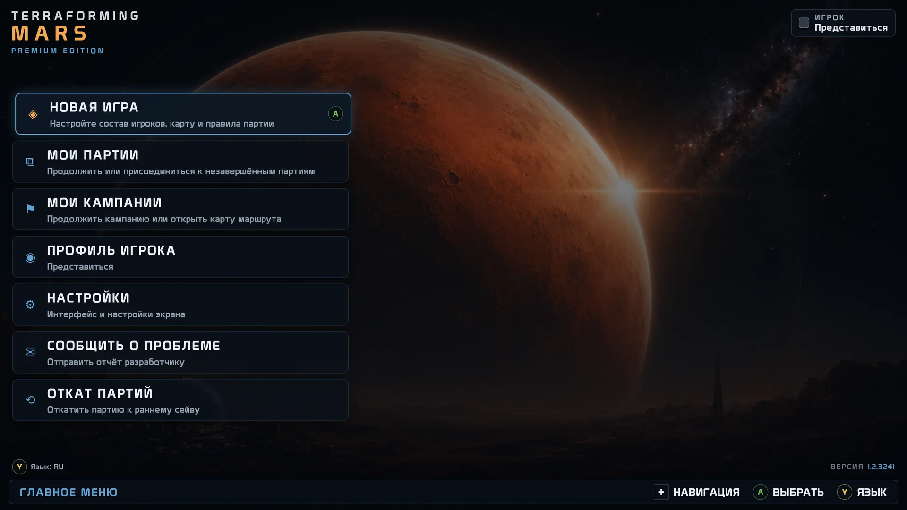

2. **Выберите, что случилось.** Пять вариантов — достаточно выбрать самый похожий.

   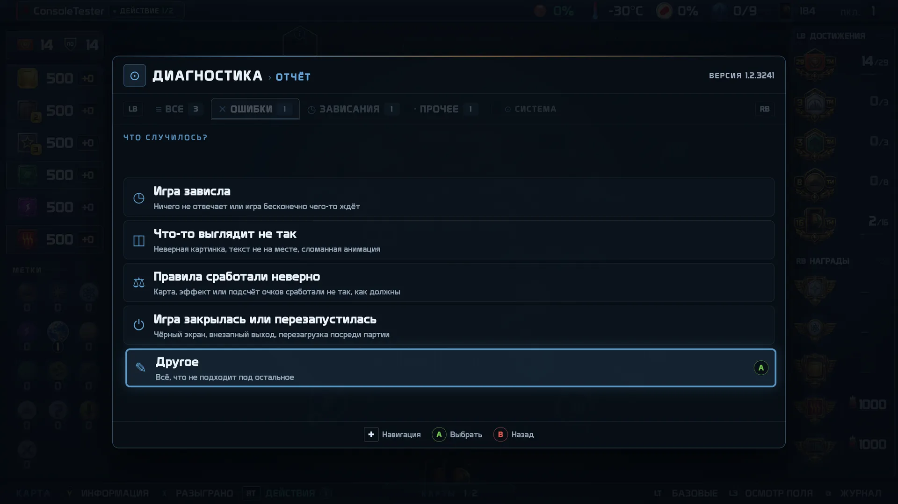

3. **Проверьте, что будет отправлено,** и, если хотите, добавьте пару слов (строка «Своими словами» — нажмите A,
   откроется экранная клавиатура). Писать не обязательно, но одна фраза «что я делал в этот момент» очень помогает.
   Нажмите **«Отправить отчёт»**.

   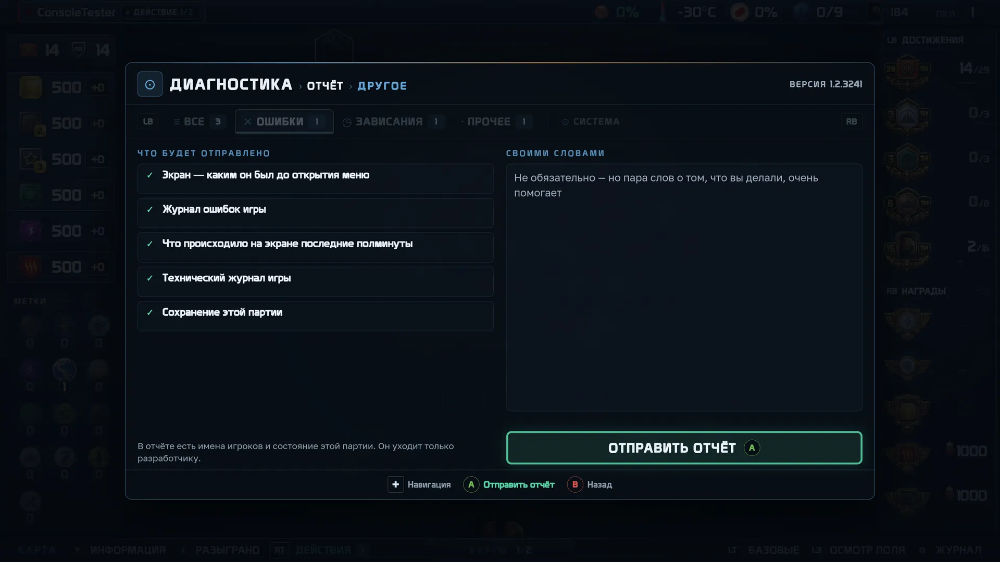

4. Через несколько секунд появится **код отчёта** — например `TM-K7QW3D`.

   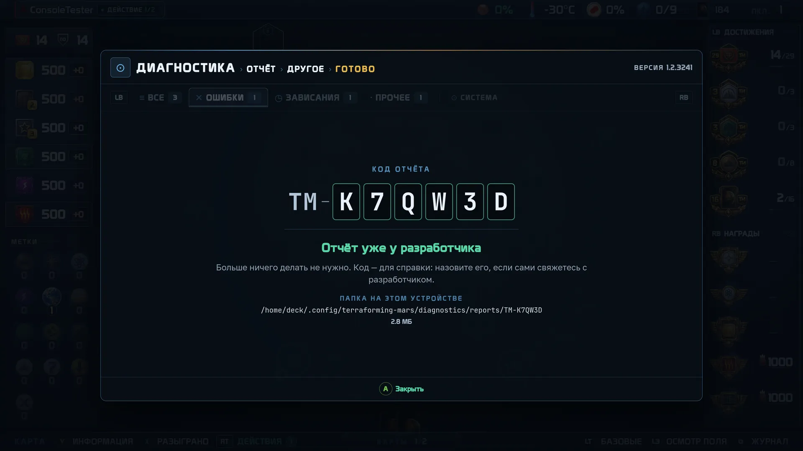

**Больше ничего делать не нужно: отчёт уже у разработчика.** Код — для справки: назовите его, если сами будете
связываться с разработчиком. Нажмите A — игра продолжится с того же места.

### Что уходит в отчёте и что — нет

Когда вы нажимаете «Отправить отчёт», уходит:

- снимок экрана — каким он был **до** открытия меню;
- журнал ошибок игры и технический журнал (что игра делала в последние минуты);
- сохранение **этой** партии — только если партия идёт на вашем устройстве;
- ваш комментарий и выбранная категория.

В отчёте есть имена игроков и состояние этой партии — без них проблему не воспроизвести. Отчёт получает только
разработчик игры.

**Не уходят:** другие ваши партии, файлы с компьютера, пароли, переписка, данные других программ. Экран не
записывается и не транслируется — делается один снимок в момент открытия меню.

### Автоматические отчёты об ошибках

Если в игре происходит ошибка, игра **сама** отправляет разработчику короткий технический отчёт: что именно сломалось
и на каком экране. В таком отчёте **нет** имён игроков, **нет** содержимого партии и **нет** адреса вашего
подключения.

Отключить: **Настройки → ДИАГНОСТИКА → «Автоотчёты об ошибках» → выкл.** После этого само ничего не уходит. Отчёты,
которые вы отправляете вручную («Сообщить о проблеме»), продолжают работать.

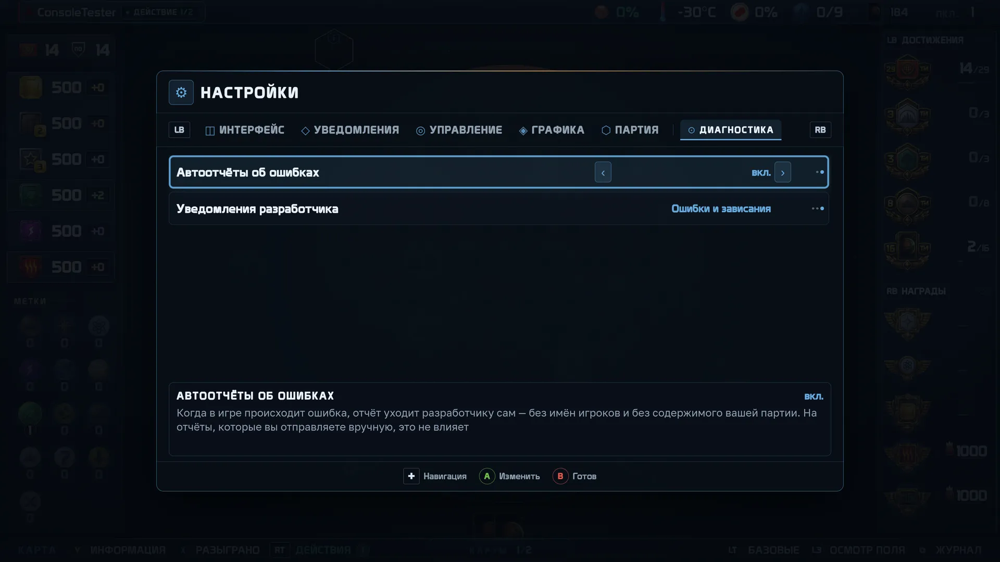

### Если нет интернета

Отчёт не пропадёт. На экране будет написано **«Отчёт уйдёт, когда появится сеть»** — он сохранён на вашем устройстве
и отправится сам: когда сеть вернётся или при следующем запуске игры.

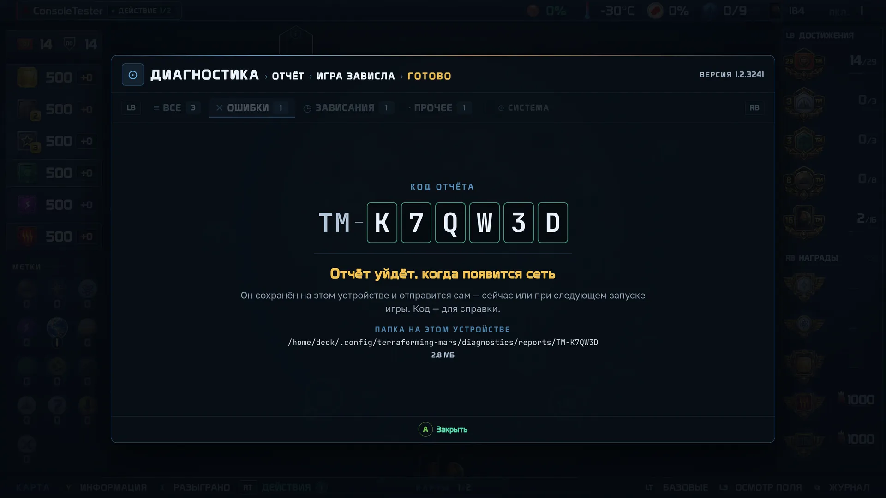

### Если отчёт не удалось собрать

Редко, но бывает: на экране написано **«Не удалось собрать отчёт»**. Ничего не отправлено и ничего не потеряно —
выбранная категория и ваш текст сохранены. Нажмите **A — «Повторить»**; **B** возвращает на шаг назад.

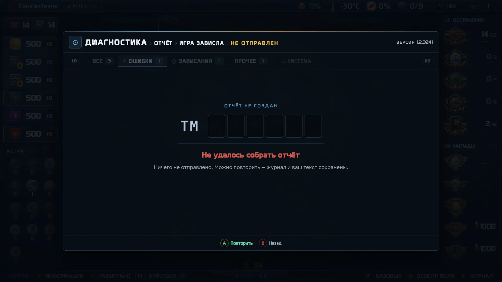

### Где лежит отчёт на устройстве

Путь к папке показан прямо на экране с кодом. Обычно это:

| Устройство | Папка |
| --- | --- |
| Windows | `%AppData%\terraforming-mars\diagnostics\reports\TM-XXXXXX\` (вставьте в адресную строку Проводника `%AppData%\terraforming-mars\diagnostics\reports`) |
| Steam Deck / Steam Machine | `~/.config/terraforming-mars/diagnostics/reports/TM-XXXXXX/` (в режиме рабочего стола: Dolphin → «Показывать скрытые файлы» → `.config`) |

Хранятся последние 20 отчётов.

### Как посмотреть журнал ошибок

**Menu → «Диагностика».** Вкладки (LB / RB): **ВСЕ · ОШИБКИ · ЗАВИСАНИЯ · ПРОЧЕЕ**, справа — **СИСТЕМА** (сведения об
устройстве и подключении). На записи нажмите **A**, чтобы прочитать её целиком; **X** копирует текст.

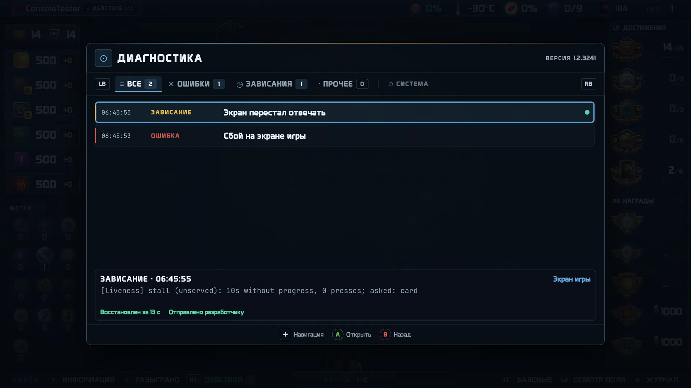

Если журнал пуст — значит, ошибок не было. Отправить отчёт можно и с пустым журналом (кнопка A).

---

## Часть 2. Тестировщикам (QA)

### Как оформить баг

1. **Сразу после проблемы** — Menu → «Сообщить о проблеме». Снимок экрана берётся в момент открытия меню, поэтому не
   уходите с экрана, где проблема видна.
2. Выберите категорию (таблица ниже) и напишите в комментарии **шаги одной фразой**: «сыграл „Научную колонию“ →
   выбрал Плутон → нажал A на втором сбросе».
3. Запишите **код отчёта**. В задаче укажите:
   - **код** (`TM-…`) — по нему находится весь пакет: журнал, консоль, снимок, сохранение;
   - **шаги** (что делали), **ожидание** (что должно было произойти), **факт** (что произошло);
   - **время** (по часам устройства) — если проблем было несколько;
   - версию игры — она написана в правом верхнем углу системного меню и окна «Диагностика».

Если баг воспроизводится — отправьте отчёт **при каждом воспроизведении**: коды разные, а разработчику важно видеть,
одинаковые ли это случаи.

### Какую категорию выбирать

| Категория | Когда |
| --- | --- |
| **Игра зависла** | экран не реагирует; игра ждёт чего-то и не продолжается; кнопки ничего не делают |
| **Что-то выглядит не так** | наложение элементов, обрезанный текст, неверная картинка, анимация «прыгает» или застряла |
| **Правила сработали неверно** | карта, эффект, подсчёт очков или цена сработали не по правилам |
| **Игра закрылась или перезапустилась** | чёрный экран, вылет, экран перезагрузился посреди партии |
| **Другое** | всё остальное |

Категория — подсказка для сортировки; ошибиться не страшно.

### Уведомления разработчика — для тестовых прогонов

Включите: **Настройки → ДИАГНОСТИКА → «Уведомления разработчика» → «Ошибки и зависания»**. Теперь игра показывает
ошибку или зависание экрана в левом нижнем углу в тот момент, когда они происходят — даже если экран «висит».

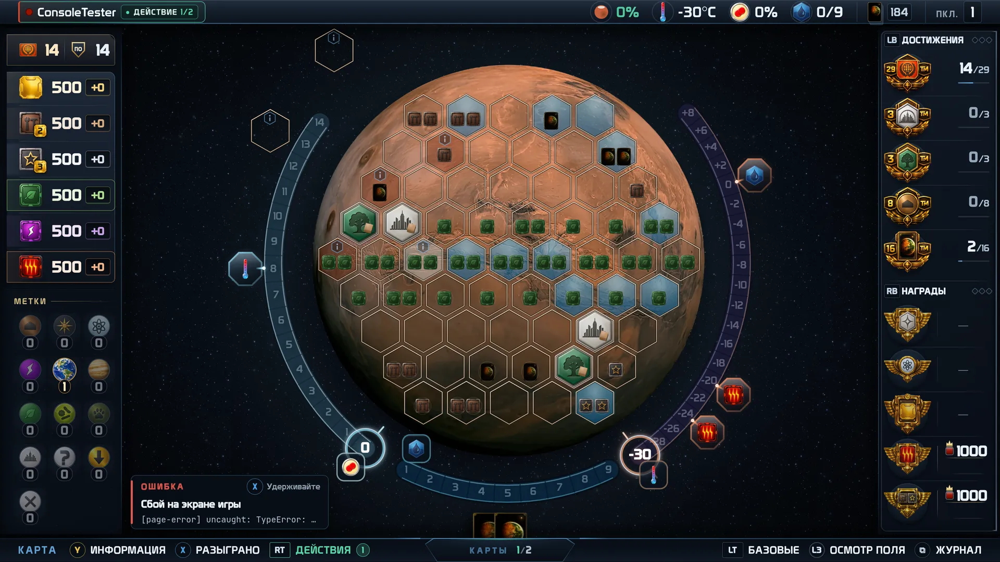

| Что на экране | Что это значит |
| --- | --- |
| Плашка **ОШИБКА** (красная кромка) | в игре произошла ошибка; партия может идти дальше как ни в чём не бывало — отчёт всё равно нужен |
| Плашка **ЗАВИСАНИЕ** (жёлтая кромка) и «Всё ещё стоит — N с» | экран не отвечает прямо сейчас; игра пробует восстановить его сама |
| …«Восстановлен за N с» | игра восстановила экран сама; игрок этого мог не заметить — но это дефект, отчёт нужен |
| …«Не восстановлен» | экран не восстановился; см. «Если игра зависла» ниже |
| Маленький значок `✕ 2 · ◷ 1` | плашка свернулась: 2 ошибки и 1 зависание ещё не открыты. Над открытым экраном (рука, колонии…) плашка сразу показывается значком |

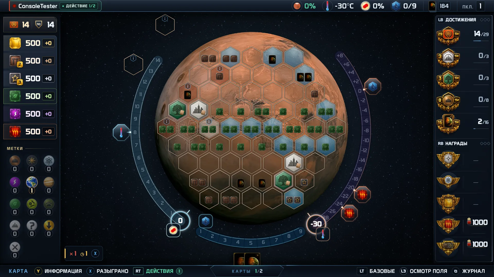

**Удерживайте X** на плашке или значке — откроется запись целиком: причина, что игра сделала для восстановления,
что было на экране. Оттуда **A** — «Сообщить о проблеме» (отчёт будет привязан к этой записи).
Короткое нажатие X работает как обычно (например, «Разыграно») — плашка его не перехватывает.

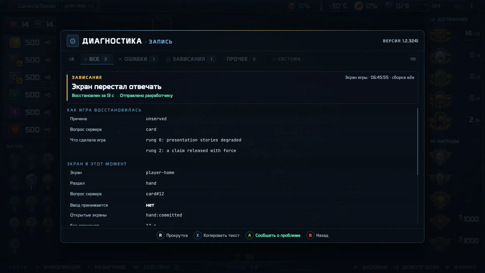

### Если игра зависла и меню не открывается

1. Подождите **30 секунд**: игра умеет восстанавливать экран сама, а если окно не отвечает совсем — перезапускает его
   и возвращает партию на то же место.
2. После восстановления (или перезапуска окна) откройте **Menu → «Диагностика»**: запись о зависании будет в журнале —
   в том числе о том, что было **до** перезапуска. Нажмите на ней A → «Сообщить о проблеме».
3. Если игра не восстановилась за минуту — закройте её (на Steam Deck / Steam Machine: кнопка Steam → «Выйти из
   игры») и запустите снова. Партия сохранена. После запуска отправьте отчёт из главного меню («Сообщить о проблеме»)
   с категорией «Игра зависла» и напишите в комментарии, что пришлось перезапустить.
4. На ПК с клавиатурой журнал открывается клавишей **F12** в любой момент.

### Проверка исправления на новой версии

1. Убедитесь, что версия обновилась (правый верхний угол системного меню).
2. Повторите шаги из задачи.
3. Если проблема **не** воспроизводится — откройте «Диагностика» и убедитесь, что во вкладках ОШИБКИ и ЗАВИСАНИЯ нет
   новых записей за время проверки (включите «Уведомления разработчика», чтобы не пропустить вылеченное зависание).
4. Если воспроизводится — отправьте новый отчёт и укажите в задаче **оба** кода: старый и новый.

### Проверка связи

**Menu → «Диагностика» → вкладка СИСТЕМА → A.** Игра отправит по одному тестовому сообщению от экрана игры,
приложения и сервера партий и покажет, какие дошли до разработчика. Если что-то не дошло — проверьте интернет и
повторите; отчёты, отправленные вручную, при этом не теряются (они ждут сети на устройстве).

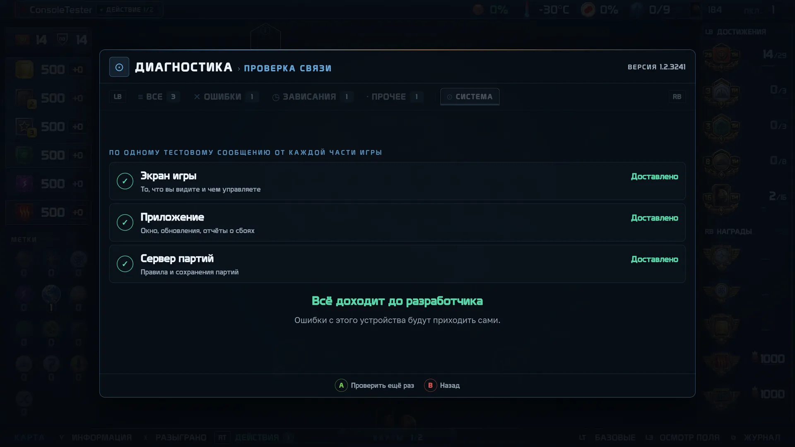
